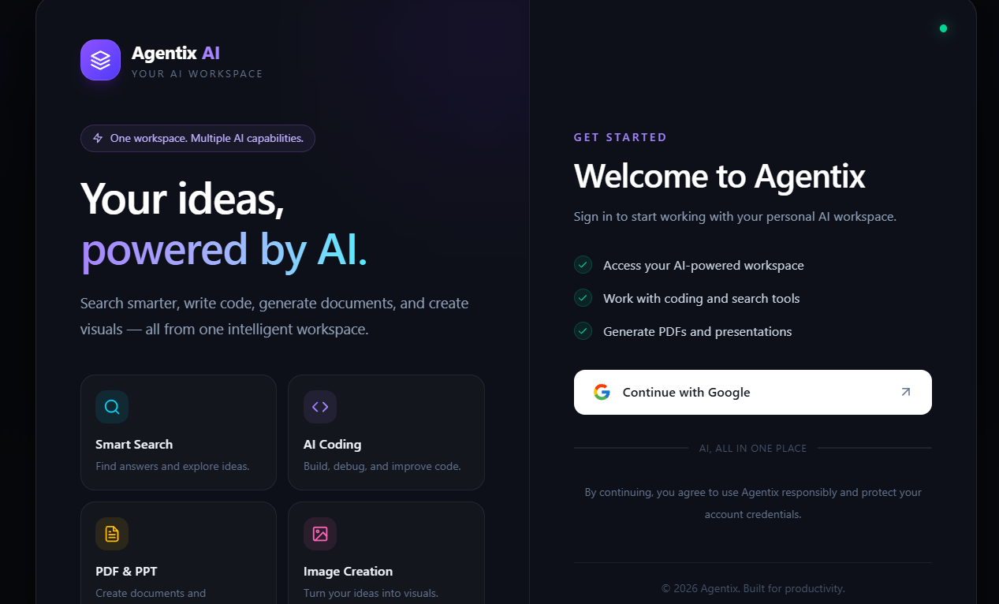

# Agentix – AI Powered Multi-Agent Web Application

**Agentix** is an AI-powered multi-agent web application designed to simplify complex tasks through intelligent AI agents. It provides a unified platform where users can interact with specialized AI agents to perform tasks such as information searching, code generation, and document creation.

Built using the **MERN Stack**, Agentix integrates multiple Large Language Models (LLMs) and AI services to deliver an interactive, scalable, and efficient AI-powered experience.

### Dashboard

---

## 🚀 Features

- **AI-Powered Chat:** Interact with AI models to get intelligent responses and assistance.
- **AI Search:** Retrieve relevant information and generate responses based on user queries.
- **Code Generation:** Generate programming code and get assistance with development-related tasks.
- **PDF Generation:** Create and generate PDF documents using AI.
- **PPT Generation:** Generate presentation slides automatically based on user prompts.
- **Image Generation:** Generate images using integrated AI image-generation services.
- **Multi-Agent Architecture:** Uses specialized agents to handle different user tasks.
- **LLM Integration:** Supports multiple AI providers, including Groq, Google Gemini, and OpenRouter.
- **User Authentication:** Secure user authentication using Firebase.
- **Conversation Management:** Manage and access previous conversations.
- **Responsive UI:** Interactive and responsive user interface for a seamless experience.

---

## 🛠️ Tech Stack

### Frontend
- React.js
- Vite
- Tailwind CSS
- Redux Toolkit
- Axios

### Backend
- Node.js
- Express.js
- MongoDB
- Redis

### AI & Agent Framework
- LangGraph
- Groq API
- Google Gemini API
- OpenRouter API
- Large Language Models (LLMs)

### Tools & Services
- Firebase Authentication
- Docker
- AWS
- npm

---

## 🏗️ System Architecture

Agentix follows a multi-agent architecture in which user requests are processed and routed to the appropriate specialized AI agent.

**Workflow:**

1. User enters a query or task through the React frontend.
2. The request is sent to the backend through REST APIs.
3. The Router Agent analyzes the user's request and identifies the appropriate task.
4. LangGraph manages the agent workflow and execution.
5. The selected specialized agent processes the request using the configured LLM or external API.
6. The generated output is returned to the backend.
7. The frontend displays the response or generated artifact to the user.

---

## 🎯 Project Objectives

- Develop an intelligent multi-agent AI platform.
- Automate multiple tasks through specialized AI agents.
- Integrate multiple LLM providers into a single application.
- Implement efficient agent orchestration using LangGraph.
- Build a scalable and user-friendly web application.

---

## 🔮 Future Enhancements

- Add more specialized AI agents.
- Improve agent collaboration and task orchestration.
- Implement real-time streaming responses.
- Add file upload and document analysis capabilities.
- Enhance conversation history and personalization.
- Improve deployment scalability and performance.

---
